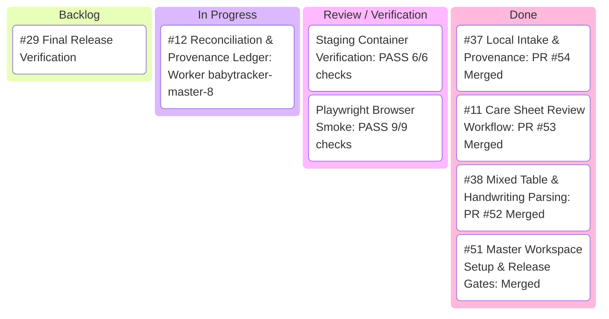

# BabyTracker Master: OCR Critical Path Kanban

**Last Updated:** 2026-11-01 (America/Chicago)  
**Orchestrator Session:** `babytracker-master-4` (`gemini-3.8-flash-medium`, interface `tui`)  
**Current Main Commit:** [`383da43dd2e68228fb8ca8927288455d60d5f80f`](https://github.com/MulattoTech/BabyTracker-Master/commit/383da43dd2e68228fb8ca8927288455d60d5f80f)  

---

## Kanban Board

---

## Work Stream Status Matrix

| Issue | Title | Owner / Session | Status | Active Worktree | PR / Deliverable |
| :--- | :--- | :--- | :---: | :--- | :--- |
| **#50** | P0 Master Tracking & Safe Release | Orchestrator (`babytracker-master-4`) | **IN PROGRESS** | `orchestrator/babytracker--orchestrator` | Overall release gate coordination |
| **#38** | Mixed feeding/diaper extraction & handwriting tolerance | Delivered | **DONE** | - | Merged in [PR #52](https://github.com/MulattoTech/BabyTracker-Master/pull/52) |
| **#37** | Local image/PDF intake, limits & provenance | Delivered | **DONE** | - | Merged in [PR #54](https://github.com/MulattoTech/BabyTracker-Master/pull/54) |
| **#11** | Care sheet review workflow UI/UX | Delivered | **DONE** | - | Merged in [PR #53](https://github.com/MulattoTech/BabyTracker-Master/pull/53) |
| **#12** | Reconciliation, deduplication & ledger | Worker (`babytracker-master-8`) | **IN PROGRESS** | `babytracker-master-8` (`ao/you-are-worker/root`) | Transactional Sprout commit & duplicate check |
| **#29** | Staging acceptance & release evidence | Release Owner | **READY** | - | Promotes pinned candidate after exact main CI |

---

## Active Coordination Directives

1. **Worker #12 (`babytracker-master-8`)**:
   - Scope: `application/src/lib/ocr/documents.ts`, `review.ts`, `contracts.ts`, and `tests/ocr-duplicates.test.ts`.
   - Exact & Fuzzy Deduplication: Match by child, event type, timestamp, amount/type values.
   - Transactional Commit: Commit approved non-rejected rows in a single database transaction; roll back cleanly on errors.
   - Idempotency: Re-importing identical files/documents must be a safe no-op that does not duplicate care events.
   - Provenance Audit: Preserve parser version, source document/page/rotation/crop, raw line text, and reviewer decisions.
   - Worktree Isolation: Strictly edit in `C:\Users\Dylan\.ao\data\worktrees\babytracker-master\babytracker-master-8`.
   - Status: Active. Dependency resolution established via `node_modules` junction; analyzing source IDs and candidate provenance.

2. **Completed Streams**:
   - **Worker #37 (`babytracker-master-6`)**: Delivered and merged in PR #54 (`f99b61c65ff61fd502c3c9c61e4c76b91c13d71e`). Bounded intake, crops, rotation, and provenance verified.
   - **Worker #11 (`babytracker-master-7`)**: Delivered and merged in PR #53 (`383da43dd2e68228fb8ca8927288455d60d5f80f`). Row merge/reject, totals, layout toggles, I18n localization verified.

3. **Release Promotion Baseline**:
   - Planned Candidate: `babytracker:git-dfe42a904d53`
   - Verified Staging Container: `babytracker-ocr-staging` (port 3124, healthy)
   - Production Container: `babytracker-sprout` (port 3123, healthy, volumes `babytracker-sprout-db`, `babytracker-sprout-env`, `babytracker-sprout-files` preserved)
