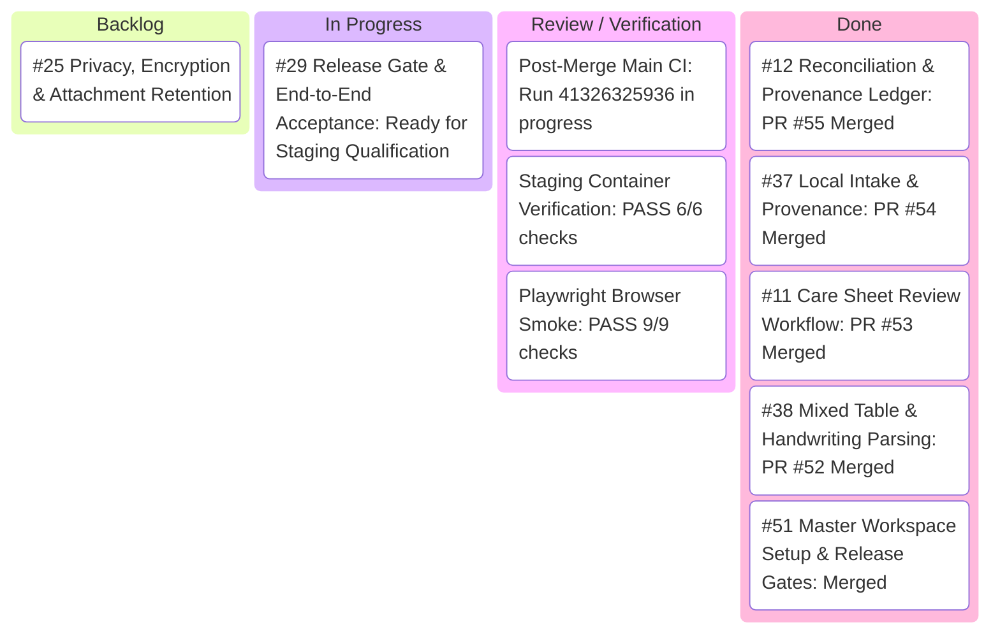

# BabyTracker Master: OCR Critical Path Kanban

**Last Updated:** 2026-11-01 (America/Chicago)  
**Orchestrator Session:** `babytracker-master-4` (`gemini-3.8-flash-medium`, interface `tui`)  
**Current Main Commit:** [`8636421b38e07be99878198f3ca77607775c742c`](https://github.com/MulattoTech/BabyTracker-Master/commit/8636421b38e07be99878198f3ca77607775c742c)  

---

## Kanban Board

---

## Work Stream Status Matrix

| Issue | Title | Owner / Session | Status | Active Worktree | PR / Deliverable |
| :--- | :--- | :--- | :---: | :--- | :--- |
| **#50** | P0 Master Tracking & Safe Release | Orchestrator (`babytracker-master-4`) | **IN PROGRESS** | `orchestrator/babytracker--orchestrator` | Overall release gate coordination |
| **#38** | Mixed feeding/diaper extraction & handwriting tolerance | Delivered | **DONE** | - | Merged in [PR #52](https://github.com/MulattoTech/BabyTracker-Master/pull/52) |
| **#37** | Local image/PDF intake, limits & provenance | Delivered | **DONE** | - | Merged in [PR #54](https://github.com/MulattoTech/BabyTracker-Master/pull/54) |
| **#11** | Care sheet review workflow UI/UX | Delivered | **DONE** | - | Merged in [PR #53](https://github.com/MulattoTech/BabyTracker-Master/pull/53) |
| **#12** | Reconciliation, deduplication & ledger | Delivered | **DONE** | - | Merged in [PR #55](https://github.com/MulattoTech/BabyTracker-Master/pull/55) |
| **#29** | Staging acceptance & release evidence | Release Owner / Orchestrator | **READY** | - | Promotes pinned candidate after exact main CI |
| **#25** | Privacy, encryption & attachment retention | Backlog | **PENDING** | - | Downstream privacy controls |

---

## Active Coordination Directives

1. **Delivered OCR Critical Path Streams**:
   - **Worker #38 (`feat/ocr-handwriting-benchmarks-and-table-parsing`)**: Merged in [PR #52](https://github.com/MulattoTech/BabyTracker-Master/pull/52). Mixed feeding/diaper extraction and handwriting benchmarks verified.
   - **Worker #37 (`babytracker-master-6`)**: Merged in [PR #54](https://github.com/MulattoTech/BabyTracker-Master/pull/54). Bounded local intake, PDF pagination, crop validation, and provenance transforms verified.
   - **Worker #11 (`babytracker-master-7`)**: Merged in [PR #53](https://github.com/MulattoTech/BabyTracker-Master/pull/53). Care sheet review UX, row merge/rejection, live totals card, layout toggles, accessibility, and 12-language localization verified.
   - **Worker #12 (`babytracker-master-8`)**: Merged in [PR #55](https://github.com/MulattoTech/BabyTracker-Master/pull/55). Multi-tier deduplication, exact provenance via `ExternalImportRecord`, transactional Sprout commit boundaries with atomic rollback, and sealed audit snapshots verified.

2. **Next Objective — Release Qualification Gate (#29)**:
   - Monitor post-merge `main` CI completion.
   - Run staging container validation drill on synthetic container `babytracker-ocr-staging` (port 3124).
   - Execute promotion build dry-run (`promote-release.ps1 -Build`).
   - Package verification evidence for user approval prior to production rollout.

3. **Production Safety Controls**:
   - Production container: `babytracker-sprout` (loopback 3123) preserved.
   - Volumes: `babytracker-sprout-db`, `babytracker-sprout-env`, `babytracker-sprout-files` untouched.
   - Zero production deployments without separate explicit user authorization.
   - Status: Active. Dependency resolution established via `node_modules` junction; analyzing source IDs and candidate provenance.

2. **Completed Streams**:
   - **Worker #37 (`babytracker-master-6`)**: Delivered and merged in PR #54 (`f99b61c65ff61fd502c3c9c61e4c76b91c13d71e`). Bounded intake, crops, rotation, and provenance verified.
   - **Worker #11 (`babytracker-master-7`)**: Delivered and merged in PR #53 (`383da43dd2e68228fb8ca8927288455d60d5f80f`). Row merge/reject, totals, layout toggles, I18n localization verified.

3. **Release Promotion Baseline**:
   - Planned Candidate: `babytracker:git-dfe42a904d53`
   - Verified Staging Container: `babytracker-ocr-staging` (port 3124, healthy)
   - Production Container: `babytracker-sprout` (port 3123, healthy, volumes `babytracker-sprout-db`, `babytracker-sprout-env`, `babytracker-sprout-files` preserved)
