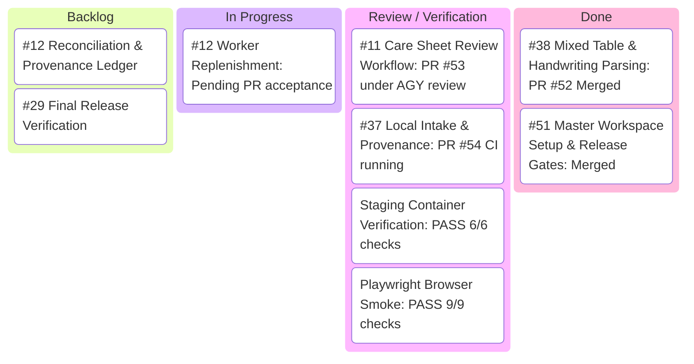

# BabyTracker Master: OCR Critical Path Kanban

**Last Updated:** 2026-11-01 (America/Chicago)  
**Orchestrator Session:** `babytracker-master-4` (`gemini-3.8-flash-medium`, interface `tui`)  
**Current Main Commit:** [`dfe42a904d535570e93eeb478f4cb52ee0fac350`](https://github.com/MulattoTech/BabyTracker-Master/commit/dfe42a904d535570e93eeb478f4cb52ee0fac350)  

---

## Kanban Board

---

## Work Stream Status Matrix

| Issue | Title | Owner / Session | Status | Active Worktree | PR / Deliverable |
| :--- | :--- | :--- | :---: | :--- | :--- |
| **#50** | P0 Master Tracking & Safe Release | Orchestrator (`babytracker-master-4`) | **IN PROGRESS** | `orchestrator/babytracker--orchestrator` | Overall release gate coordination |
| **#38** | Mixed feeding/diaper extraction & handwriting tolerance | Delivered | **DONE** | - | Merged in [PR #52](https://github.com/MulattoTech/BabyTracker-Master/pull/52) |
| **#37** | Local image/PDF intake, limits & provenance | Worker (`babytracker-master-6`) | **IN REVIEW** | `babytracker-master-6` (`ao/work-immediately-on/root`) | [PR #54](https://github.com/MulattoTech/BabyTracker-Master/pull/54) |
| **#11** | Care sheet review workflow UI/UX | Worker (`babytracker-master-7`) | **IN REVIEW** | `babytracker-master-7` (`ao/implement-a-p0/root`) | [PR #53](https://github.com/MulattoTech/BabyTracker-Master/pull/53) |
| **#12** | Reconciliation, deduplication & ledger | Pending #11 & #37 | **QUEUED** | - | Transactional Sprout commit & duplicate check |
| **#29** | Staging acceptance & release evidence | Release Owner | **READY** | - | Promotes pinned candidate after exact main CI |

---

## Active Coordination Directives

1. **Worker #37 (`babytracker-master-6`)**:
   - Scope: `application/src/lib/ocr/intake.ts`, `UploadPanel.tsx`, and intake tests.
   - Resource Bounds: Enforce <=12 MB, <=6 PDF pages, <=24M pixels.
   - Provenance: Ensure image rotation (0, 90, 180, 270) and crop survive without metadata loss.
   - Security: Validate zero external network requests and local-only worker sandboxing.
   - Worktree Isolation: Strictly edit in `babytracker-master-6`.

2. **Worker #11 (`babytracker-master-7`)**:
   - Scope: `application/src/components/OcrImport/` (`RowEditor.tsx`, `ReviewActions.tsx`, `SourcePanel.tsx`).
   - Mobile/Tablet Ergonomics: Verify side-by-side / stacked responsive layouts.
   - Validation & Ambiguity: Ensure incomplete or ambiguous required fields block commit until reviewed.
   - Actions: Verify add, split, merge, delete, and reject row controls.
   - Accessibility: Keyboard navigation, ARIA attributes, and non-destructive back navigation.
   - Worktree Isolation: Strictly edit in `babytracker-master-7`.

3. **Release Promotion Baseline**:
   - Planned Candidate: `babytracker:git-dfe42a904d53`
   - Verified Staging Container: `babytracker-ocr-staging` (port 3124, healthy)
   - Production Container: `babytracker-sprout` (port 3123, healthy, volumes `babytracker-sprout-db`, `babytracker-sprout-env`, `babytracker-sprout-files` preserved)
